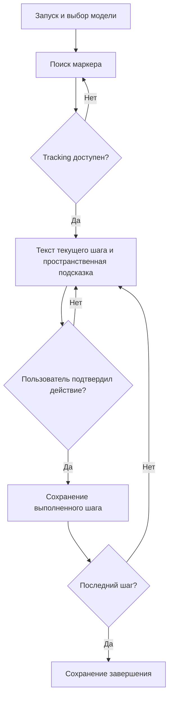
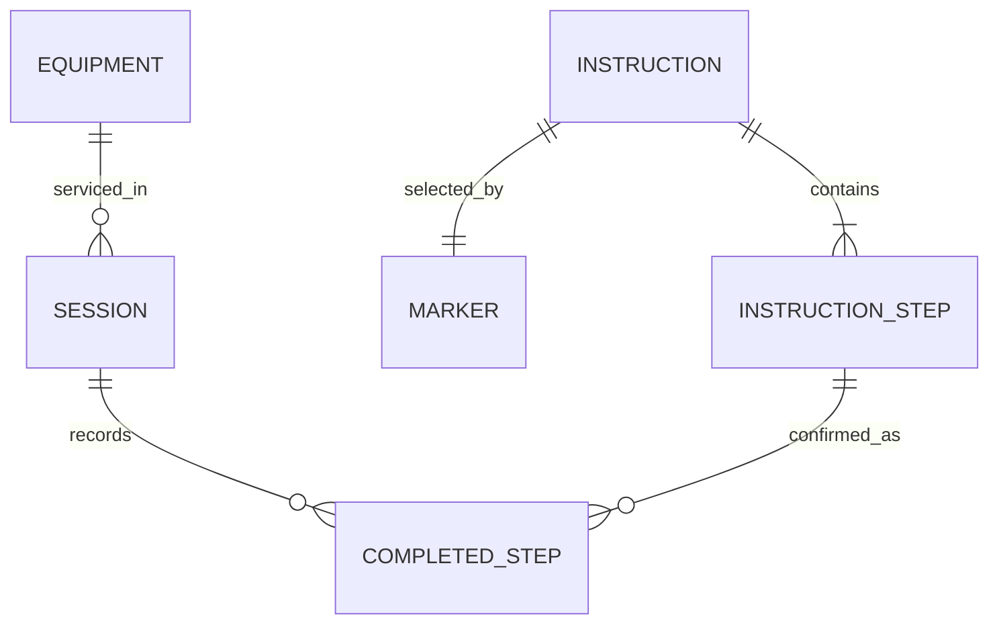

# Проектное решение

Пользователь направляет камеру Android на маркер около PS5, выбирает семейство модели,
последовательно подтверждает действия и получает локально сохранённый результат.
Приложение сопровождает отключение питания, снятие наружных крышек, визуальный осмотр
доступных участков и установку крышек. Автоматическую диагностику консоли оно не выполняет.

## Основной процесс

Эта блок-схема описывает алгоритм; для аналитического этапа бизнес-процесс можно отдельно оформить в BPMN.
Автоматизируются поиск связанной с маркером инструкции, показ текущего шага, переходы и запись результата.
Физические действия и оценка состояния оборудования выполняются пользователем.

## Объекты и обязанности

| Компонент | Ответственность |
| --- | --- |
| InstructionData / InstructionStep | Данные инструкции и варианты текста |
| MaintenanceSession | Состояние, подтверждение, порядок и завершение |
| EquipmentLayout | Координаты относительно маркера, модель и статус калибровки |
| MaintenanceApp | UI и взаимодействие с AR Foundation |
| IProgressRepository | Контракт сохранения для C# |
| JsonProgressRepository | Сохранение в режиме ПК |
| JavaProgressRepository | Вызов Java через JNI на Android |
| SessionRepository | Java интерфейс |
| SqliteSessionRepository | Наследование SQLiteOpenHelper и реализация интерфейса |
| MaintenanceBridge | Методы для C# |

Переключение шага — O(1). Инициализация состояния и массива выполненных шагов — O(n), память — O(n).
Поиск подходящего маркера в наборе отслеживаемых изображений — O(m); в проекте эталон один.
В SQLite контроль предшествующих шагов и полноты требует просмотра до n записей; для учебной инструкции n = 10.
Сложность внутреннего компьютерного зрения ARCore не оценивается как сложность собственного алгоритма.

## Логическая модель

Инструкция содержит упорядоченные шаги; маркер связан с инструкцией.
Сеанс обслуживания относится к оборудованию и выбранной модели. Сеанс содержит выполненные шаги.
В прототипе статические инструкции хранятся в JSON, записи сеансов — в локальной базе.

Физическая SQLite-модель хранит только сеансы и выполненные шаги, а не весь набор логических сущностей.
Порядковый номер соответствует позиции в зафиксированной инструкции из приложения.
Если инструкции станут редактируемыми, следует добавить идентификатор и версию инструкции в сеанс.

## Ограничения первого прототипа

Полный CFI-номер не получен. Геометрия условная; координаты не проверены на настоящем оборудовании.
Вторая сторона требует отдельной калибровки после изменения положения корпуса.
Не реализованы авторизация, сервер, удалённый редактор инструкций, распознавание деталей и диагностика повреждений.
Приложение фиксирует подтверждение пользователя и не доказывает физическое выполнение действия.
